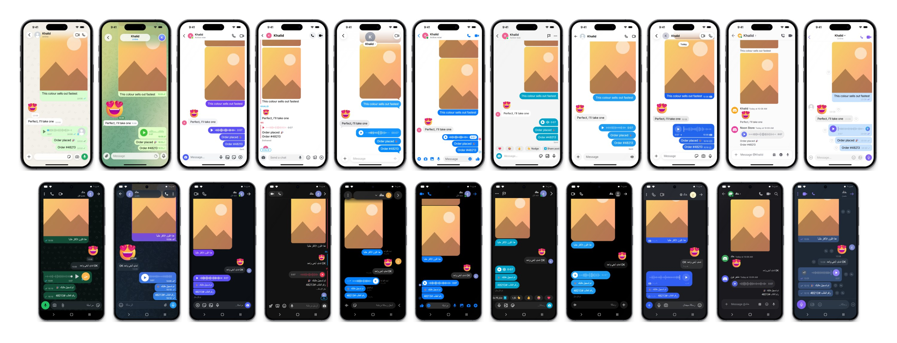
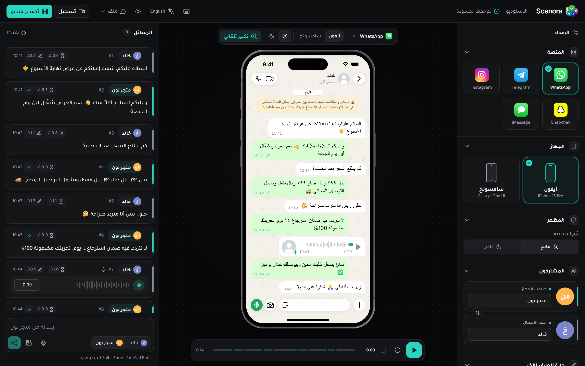
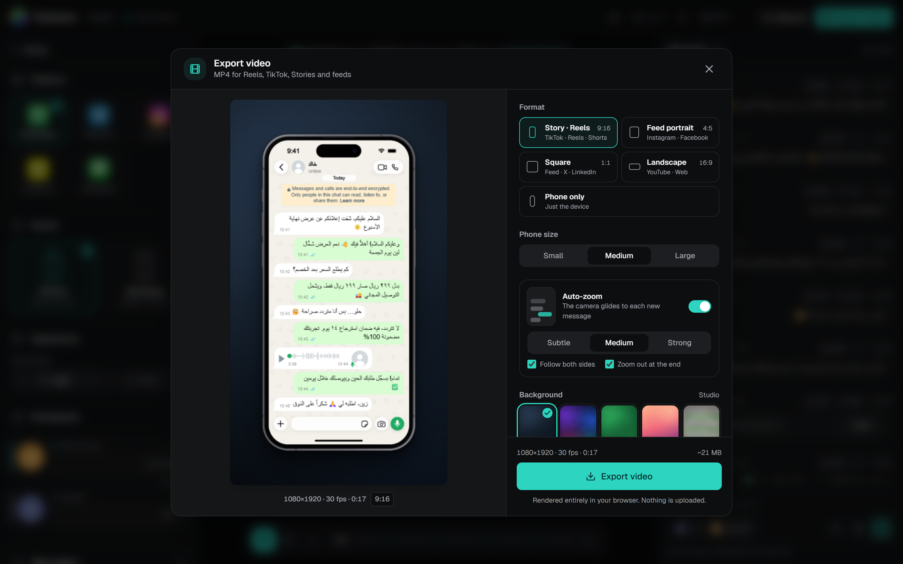
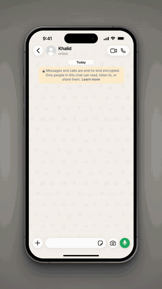
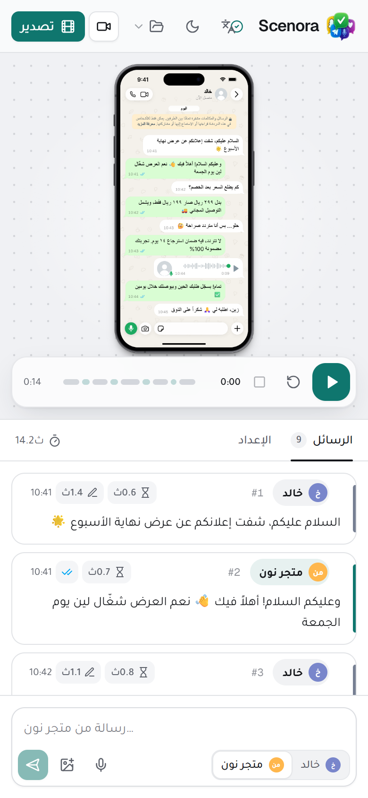

<div dir="rtl">

<div align="center">


# Scenora

**محاكاة محادثات مطابقة للتطبيقات الحقيقية: واتساب وتيليجرام وإنستغرام وسناب شات وآي مسج وماسنجر وتيك توك وX وسيجنال وديسكورد وفايبر، على آيفون أو سامسونج حقيقي، مع تصدير فيديو كامل داخل المتصفح.**

[](https://github.com/moatasem-alhilali/visual-chatsnap/actions/workflows/ci.yml)
[](LICENSE)
[](https://nextjs.org)
[](CONTRIBUTING.md)

[**النسخة الحية**](https://visual-chatsnap.vercel.app) · [**English**](README.md) · [الإبلاغ عن مشكلة](https://github.com/moatasem-alhilali/visual-chatsnap/issues/new?template=bug_report.yml) · [اقتراح ميزة](https://github.com/moatasem-alhilali/visual-chatsnap/issues/new?template=feature_request.yml)



</div>

## لماذا Scenora؟

المسوّقون والوكالات وأصحاب المتاجر وصنّاع المحتوى يحتاجون كثيرًا إلى شاشة محادثة مقنعة لإعلان أو عرض منتج أو شرح أو قصة. الخيارات المعتادة سيئة: إما لقطة من محادثة حقيقية (بيانات خاصة ولا تحكم فيها)، أو واجهة محادثة عامة يبان عليها أنها مزيفة.

Scenora يتعامل مع كل تطبيق كمنتج مستقل. **واتساب على iOS وواتساب على أندرويد قالبان منفصلان**، وكل واحد منهما مبني من التصميم الحالي للتطبيق الحقيقي: الألوان، وشكل الفقاعات وذيلها، وعلامات القراءة، والخطوط، والأيقونات، وشارات التاريخ، وشريط الكتابة، والخلفيات، وإشعارات التسليم، ومؤشر الكتابة، وحركة ظهور الرسائل. بعدها تُعرض المحادثة كأنها تسجيل شاشة، وتقدر تصدّرها فيديو MP4 بدون رفع أي شيء.

## المزايا

### 22 قالبًا (11 تطبيقًا × آيفون وسامسونج)

| التطبيق | آيفون (iOS 26) | سامسونج جالكسي (One UI 8) |
| --- | --- | --- |
| **واتساب** | تصميم Liquid Glass (إصدار سبتمبر 2026) وصور بدون إطار | تصميم Material 3 مع شريط كتابة عائم وزر مايك أخضر |
| **تيليجرام** | مبني من كود Telegram-iOS مفتوح المصدر مع الخلفية الأصلية | مبني من كود Telegram Android مفتوح المصدر |
| **إنستغرام** | تدرّج بنفسجي→أزرق مرتبط بالشاشة، وزوايا مجمّعة، و«تمت المشاهدة» | مقاسات أندرويد وسهم رجوع Material |
| **سناب شات** | أسماء المرسلين وأشرطة ملونة، وأيقونات سناب الأصلية | تصميم سناب الموحد بإطار أندرويد |
| **آي مسج** ← **رسائل سامسونج** | ذيل iOS 26 الجديد، وأزرق متدرّج، و«تم التسليم / تمت القراءة» | آي مسج غير موجود على أندرويد، فيظهر بدلًا منه تطبيق رسائل سامسونج (One UI 8.5) |
| **ماسنجر** | أزرق ماسنجر، وعلامة المشاهدة بصورة الطرف الآخر، وزر اللايك | شريط أندرويد ومقاساته بنفس قيم Meta |
| **تيك توك** (الرسائل) | مأخوذ من صور TikTok الرسمية لعام 2025: فقاعات سماوية، وردود سريعة، وخط TikTok Sans | نفس التصميم بإطار أندرويد |
| **X** (Chat) | مأخوذ من لقطة متجر آبل لإصدار أكتوبر 2026: فقاعات كاملة الاستدارة و«Seen» | أيقونات X Chat ونصوصه الرسمية |
| **سيجنال** | مبني من كود Signal-iOS: أزرق متدرّج وتصميم iOS 26 الزجاجي | مبني من كود Signal-Android ومطابق للقطة حقيقية |
| **ديسكورد** (الرسائل) | تحديث أغسطس 2026: شريط كتابة عائم وألوان العميل الرسمية | نفس التحديث بإطار أندرويد. ديسكورد لا يدعم العربية، فيبقى إنجليزيًا كما في الجوال الحقيقي |
| **فايبر** | مأخوذ من لقطات متجر آبل: فقاعات زرقاء فاتحة، وتفاعل القلب، وعلامات قراءة بنفسجية | مأخوذ من لقطات Google Play على سامسونج |

كل القوالب تدعم:

- **الوضعين الفاتح والداكن** بألوان كل تطبيق الحقيقية.
- **الاتجاه من اليمين لليسار** للعربية، بنفس سلوك كل تطبيق. تيليجرام مثلًا لا يعكس المحادثة. وكل فقاعة تكتشف اتجاه نصها بنفسها.
- **أنواع الرسائل:** نص، وإيموجي كبير بدون فقاعة، ورسائل صوتية، وصور مع تعليق أو بدونه.
- **تجميع الرسائل** المتتالية من نفس المرسل.
- **الحالة:** مراحل التسليم (إرسال ← تسليم ← قراءة) بعلامات كل تطبيق، ومؤشر الكتابة، والحالة (متصل / يكتب / آخر ظهور).
- **حركة ظهور خاصة بكل تطبيق ونظام**، تستخدمها المعاينة والتصدير معًا.

### أجهزة واقعية

- **iPhone 15 Pro** (شاشة 393 × 852 نقطة): Dynamic Island، وإطار تيتانيوم، وأزرار في أماكنها الحقيقية، وشريط حالة iOS 26 مقاس من صور Apple.
- **Galaxy S25** (شاشة 360 × 780): كاميرا في المنتصف، وشريط حالة One UI 8 بأرقام عربية في الواجهة العربية، وشريط تنقل ||| ○ <.
- **الخطوط:** تقدر تغيّر خط سامسونج (Roboto / Cairo / Tajawal). والعربية تظهر بخط عربي حقيقي على الجهازين.

### الاستوديو

- **التخطيط:** ثلاث مناطق (الإعداد · المسرح · الرسائل)، تتحول إلى تبويبات على التابلت ولوحة سفلية على الجوال.
- **محرر الرسائل:** تعديل مباشر، وتبديل المرسل، وإعادة ترتيب بالسحب، ونسخ وحذف مع تراجع، ورسائل صوت وصور، وتوقيت لكل رسالة (التأخير ومدة الكتابة) وحالتها.
- **شريط التشغيل:** شريط زمني مقسّم تضغط عليه للانتقال لأي رسالة، و**وضع تسجيل** بشاشة كاملة نظيفة لتسجيل الشاشة.
- **الحفظ والمشاركة:** حفظ تلقائي، وحفظ واسترجاع في المتصفح، واستيراد وتصدير السيناريو بصيغة JSON.
- **الاختصارات والمظهر:** اختصارات لوحة المفاتيح، وثيم فاتح وداكن للاستوديو نفسه.
- **واجهة بلغتين** (عربي / إنجليزي) مع بيانات SEO مترجمة.

### تصدير الفيديو (داخل المتصفح)

- **المقاسات:** 9:16 (ريلز · تيك توك · شورتس)، و4:5، و1:1، و16:9، أو الجهاز فقط.
- **الجودة:** 30 أو 60 إطار في الثانية، وثلاث مستويات جودة، وترميز H.264 High مع بدائل تلقائية HEVC / VP9 / AV1.
- **🎥 الكاميرا التلقائية (Auto-zoom):** الكاميرا تقترب بنعومة من كل رسالة جديدة وتتنقل بين الطرفين على طريقة Screen Studio. وتشتغل كذلك مباشرة داخل الاستوديو.
- **الشكل:** خلفيات احترافية (منها خلفية الشاشة المموّهة)، وظل يتكيف مع لون الخلفية.
- **التوقيت والصوت:** وقفة اختيارية في البداية والنهاية، وأصوات إرسال واستقبال مولّدة (اختيارية).
- **الخصوصية:** لا يُرفع أي شيء. كل شيء يتم في متصفحك عبر WebCodecs و[snapdom](https://github.com/zumerlab/snapdom) و[mp4-muxer](https://github.com/Vanilagy/mp4-muxer).

## لقطات

<table>
  <tr>
    <td width="50%"></td>
    <td width="50%"></td>
  </tr>
  <tr>
    <td align="center"><sub>الاستوديو بالعربية، الوضع الداكن</sub></td>
    <td align="center"><sub>نافذة التصدير</sub></td>
  </tr>
  <tr>
    <td align="center"></td>
    <td align="center"></td>
  </tr>
  <tr>
    <td align="center"><sub>الكاميرا التلقائية في الفيديو المُصدَّر</sub></td>
    <td align="center"><sub>تخطيط الجوال</sub></td>
  </tr>
</table>

## التشغيل السريع

**المتطلبات:** Node.js بإصدار **20.9 أو أحدث** (يُنصح بـ 22 LTS) و npm.

<div dir="ltr">

```bash
git clone https://github.com/moatasem-alhilali/visual-chatsnap.git
cd visual-chatsnap
npm install
npm run dev
```

</div>

افتح <http://localhost:3000>، وسيحوّلك تلقائيًا إلى `/ar` (أو استخدم `/en` للإنجليزية). لا تحتاج أي متغيرات بيئة ولا خادم خلفي.

| الأمر | الوظيفة |
| --- | --- |
| `npm run dev` | تشغيل خادم التطوير |
| `npm run build` | بناء نسخة الإنتاج |
| `npm run start` | تشغيل نسخة الإنتاج |
| `npm run lint` | فحص ESLint |
| `npm run typecheck` | فحص TypeScript |
| `npm run verify` | الفحوصات الثلاثة معًا (نفس ما يشغله CI) |

## طريقة الاستخدام

1. **اختر التطبيق والجهاز** من لوحة الإعداد أو من الشريط العائم فوق الجوال.
2. **حدّد الأشخاص:** الاسم والصورة لك وللطرف الآخر، وحالته، وأيقونات شريط الحالة.
3. **اكتب المحادثة** في لوحة الرسائل. <kbd>Enter</kbd> للإضافة، و<kbd>Ctrl</kbd> + <kbd>Enter</kbd> للإضافة مع تبديل المرسل. وافتح أي رسالة لتعديل نوعها ووقتها وحالتها وتوقيتها.
4. **اضغط تشغيل.** تظهر الرسائل بحركة التطبيق الأصلية، مع مؤشر الكتابة وتغيّر علامات التسليم والقراءة. فعّل **التكبير التلقائي** من الشريط لمعاينة الكاميرا.
5. **صدّر الفيديو** أو استخدم **وضع التسجيل** لتسجيل الشاشة.

**الاختصارات:** <kbd>Space</kbd> تشغيل/إيقاف · <kbd>R</kbd> إعادة · <kbd>N</kbd> رسالة جديدة · <kbd>Ctrl</kbd>+<kbd>D</kbd> نسخ · <kbd>Delete</kbd> حذف · <kbd>Alt</kbd>+<kbd>↑</kbd>/<kbd>↓</kbd> نقل · <kbd>Ctrl</kbd>+<kbd>S</kbd> حفظ · <kbd>F</kbd> وضع التسجيل · <kbd>E</kbd> تصدير · <kbd>?</kbd> كل الاختصارات.

## للمطورين

- كل قالب (تطبيق × نظام) ملف مستقل في `src/features/studio/components/platforms/`، وكل قالب يُحمَّل عند الحاجة فقط.
- القوالب تلتزم بعقد واضح:
  - سمتا `data-mid` و`data-sender` على كل رسالة.
  - تصدير `PlatformMotion` يطابق حركة الظهور.
  - استخدام `clockMs` للحركات المتكررة أثناء التصدير.
- لالتقاط صورة لأي قالب أثناء التطوير:

<div dir="ltr">

```bash
node scripts/shot.mjs out/tg.png platform=telegram device=android theme=dark lang=ar
```

</div>

التفاصيل الكاملة (البنية، ومسار التصدير، وإضافة قالب جديد، والإعدادات، والنشر) موجودة في [README بالإنجليزية](README.md) و[دليل المساهمة](CONTRIBUTING.md).

## الاستخدام المسؤول والعلامات التجارية

Scenora أداة **محاكاة إبداعية** للإعلانات والشروحات والقصص وعروض الواجهات والتعليم.

- **لا تستخدمه للخداع.** لا تنشئ محادثات مزيفة بقصد الاحتيال أو انتحال الشخصية أو الإساءة أو تضليل أحد أو تزوير أدلة. أنت مسؤول عن طريقة استخدامك لما تنشئه، وعن الالتزام بالأنظمة وسياسات المنصات.
- **العلامات التجارية:** واتساب وإنستغرام علامتان لشركة Meta، وتيليجرام لشركة Telegram FZ-LLC، وسناب شات لشركة Snap، وتيك توك لشركة ByteDance، وX لشركة X Corp، وسيجنال لمؤسسة Signal Technology Foundation، وديسكورد لشركة Discord Inc.، وفايبر لشركة Rakuten Viber، وآي مسج وآيفون لشركة Apple، وسامسونج وجالكسي وOne UI لشركة Samsung. هذا المشروع **غير تابع لأي منها ولا مدعوم منها**. الواجهات أعيد رسمها من الصفر لأغراض التوضيح، ولا يتضمن المشروع أي ملفات رسمية.

## المساهمة والترخيص

كل المساهمات مرحّب بها: تحسينات دقة التصميم، وقوالب جديدة، وترجمات، وتوثيق. اقرأ [دليل المساهمة](CONTRIBUTING.md) و[ميثاق السلوك](CODE_OF_CONDUCT.md). وللثغرات الأمنية راجع [SECURITY.md](SECURITY.md) ولا تفتح Issue عامًا.

الترخيص: [MIT](LICENSE) © معتصم الهلالي والمساهمون.

<div align="center"><sub>إذا أفادك Scenora لا تنسَ تعطيه ⭐ عشان يوصل لغيرك.</sub></div>

</div>
