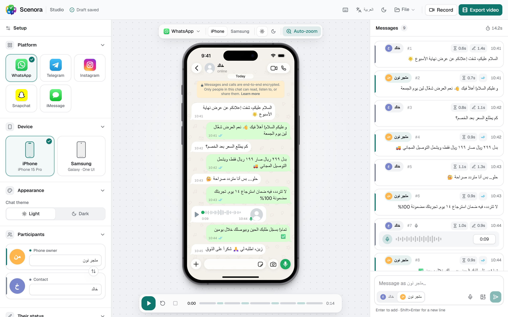
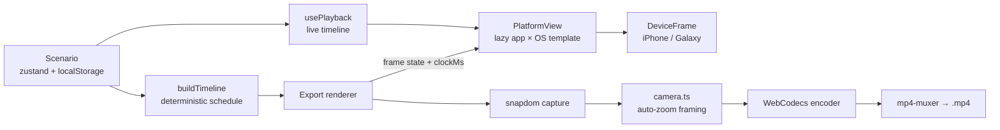

<div align="center">


# Scenora

**Pixel-accurate chat mockups for WhatsApp, Telegram, Instagram, Snapchat and iMessage, on a real iPhone or Samsung, exported as video entirely in the browser.**

[](https://github.com/moatasem-alhilali/visual-chatsnap/actions/workflows/ci.yml)
[](LICENSE)
[](https://nextjs.org)
[](https://react.dev)
[](https://www.typescriptlang.org)
[](CONTRIBUTING.md)

[**Live demo**](https://visual-chatsnap.vercel.app) · [**العربية**](README.ar.md) · [Report a bug](https://github.com/moatasem-alhilali/visual-chatsnap/issues/new?template=bug_report.yml) · [Request a feature](https://github.com/moatasem-alhilali/visual-chatsnap/issues/new?template=feature_request.yml)


</div>

---

## Table of contents

- [Why Scenora](#why-scenora)
- [Features](#features)
- [Screenshots](#screenshots)
- [Quick start](#quick-start)
- [Using the studio](#using-the-studio)
- [Video export](#video-export)
- [How it works](#how-it-works)
- [Project structure](#project-structure)
- [Adding or improving a platform template](#adding-or-improving-a-platform-template)
- [Configuration](#configuration)
- [Deployment](#deployment)
- [Browser support](#browser-support)
- [Responsible use and trademarks](#responsible-use-and-trademarks)
- [Roadmap](#roadmap)
- [Contributing](#contributing)
- [License](#license)

---

## Why Scenora

Marketers, agencies, e-commerce owners and content creators often need a convincing chat screen for an ad, a product demo, a tutorial or a story. The usual options are a screenshot of a real conversation (private data, no control) or a generic "chat UI" that looks fake.

Scenora treats each app as its own product. **WhatsApp on iOS and WhatsApp on Android are two separate templates**, each rebuilt from the real app's current design: colours, bubble geometry, tails, ticks, typography, icons, date chips, composers, wallpapers, receipts, typing indicators and entrance motion. The conversation then plays back like a screen recording, and you can export it as an MP4 without uploading anything.

## Features

### Ten app × OS templates

| App | iPhone (iOS 26) | Samsung Galaxy (One UI 8) |
| --- | --- | --- |
| **WhatsApp** | Liquid Glass chat (Sept 2026 rollout), frameless media, rounder bubbles | Material 3 redesign, floating composer, green mic FAB |
| **Telegram** | Built from the open-source Telegram-iOS theme code and the real doodle wallpaper | Built from the open-source Telegram Android code (glass top bar, input island) |
| **Instagram Direct** | Screen-anchored purple→blue gradient, grouped corners, "Seen" receipts | Android metrics, Material back arrow, same design tokens |
| **Snapchat** | Sender labels and coloured bars, real production icons, Bitmoji-style presence | Snapchat's cross-platform design on Android chrome |
| **iMessage** → **Samsung Messages** | iOS 26 tail shape, gradient blue, "Delivered / Read" labels | iMessage doesn't exist on Android, so Galaxy devices get Samsung Messages (One UI 8.5) |

Every template supports:

- **Light and dark** palettes, using each app's real values.
- **Full RTL** mirroring for Arabic, matching each app's own behaviour. Telegram, for example, doesn't mirror the thread. Each bubble also detects its own text direction.
- **Message types:** text, emoji-only (rendered large like the real apps), voice notes, images with or without a caption.
- **Grouping,** with grouped corners and tails per app.
- **Status:** delivery status (sent → delivered → read) with each app's own glyphs and labels, typing indicators, and presence (online / typing / last seen).
- **Platform-specific entrance animations,** used by both live playback and video export.

### Realistic devices

- **iPhone 15 Pro** (393 × 852 pt screen): Dynamic Island, titanium rail, real button positions, and an iOS 26 status bar measured from Apple's renders.
- **Samsung Galaxy S25** (360 × 780 dp screen): centred punch-hole and a One UI 8 status bar with Arabic-Indic digits in Arabic and the ||| ○ < navigation bar.
- **Fonts:** Samsung's system font can be switched (Roboto / Cairo / Tajawal). Arabic text renders in a proper Arabic face on both devices.

### Studio

- **Layout:** a three-zone editor (setup · stage · messages) that becomes tabs on tablets and a bottom panel on phones.
- **Message editor:** inline editing, sender switching, drag to reorder, duplicate and delete with undo, voice and image messages, per-message timing (delay, typing duration) and status.
- **Playback bar:** a segmented timeline you can click to jump to a message, and a **recording mode** (a clean full-screen stage for screen capture).
- **Saving and sharing:** autosave, save/load in the browser, import/export scenario JSON.
- **Keyboard and appearance:** keyboard shortcuts, plus light and dark themes for the studio itself.
- **Bilingual UI** (Arabic / English) with localized SEO metadata.

### Video export (in the browser)

- **Formats:** 9:16 (Reels · TikTok · Shorts), 4:5, 1:1, 16:9, or phone only.
- **Output:** 30 or 60 fps, three quality levels, H.264 High with automatic HEVC / VP9 / AV1 fallback.
- **Auto-zoom camera:** the camera glides to each new message and follows the conversation between both sides, Screen Studio style. It works live in the studio too.
- **Look:** premium backgrounds (including a blurred-screen backdrop), and a shadow that adapts to the background.
- **Timing and sound:** optional intro/outro holds and synthesized send/receive sounds.
- **Privacy:** nothing is uploaded. Rendering uses WebCodecs + [snapdom](https://github.com/zumerlab/snapdom) + [mp4-muxer](https://github.com/Vanilagy/mp4-muxer) in your browser.

## Screenshots

<table>
  <tr>
    <td width="50%"></td>
    <td width="50%"></td>
  </tr>
  <tr>
    <td align="center"><sub>Studio, English, light</sub></td>
    <td align="center"><sub>Studio, Arabic (RTL), dark</sub></td>
  </tr>
  <tr>
    <td width="50%"></td>
    <td width="50%" align="center">
      
      &nbsp;
      
    </td>
  </tr>
  <tr>
    <td align="center"><sub>Export dialog</sub></td>
    <td align="center"><sub>Auto-zoom in an exported video · mobile layout</sub></td>
  </tr>
</table>

## Quick start

**Requirements:** Node.js **20.9+** (22 LTS recommended) and npm.

```bash
git clone https://github.com/moatasem-alhilali/visual-chatsnap.git
cd visual-chatsnap
npm install
npm run dev
```

Open <http://localhost:3000>. It redirects to `/ar`; use `/en` for English. No environment variables or backend are needed to run the studio.

| Command | What it does |
| --- | --- |
| `npm run dev` | Start the dev server (Turbopack) |
| `npm run build` | Production build |
| `npm run start` | Serve the production build |
| `npm run lint` | ESLint |
| `npm run typecheck` | TypeScript, no emit |
| `npm run verify` | typecheck + lint + build (what CI runs) |

## Using the studio

1. **Pick the app and the device** from the setup panel or the floating toolbar above the phone. With iMessage selected, choosing Samsung shows Samsung Messages.
2. **Set the people:** names and photos for you and the contact, their presence, and the status-bar icons.
3. **Write the conversation** in the messages panel. Press <kbd>Enter</kbd> to add, <kbd>Ctrl</kbd>/<kbd>⌘</kbd> + <kbd>Enter</kbd> to add and switch sender. Expand a row for type, time, status, delay and typing duration.
4. **Press play.** Messages appear with the app's own motion, typing indicators and live sent → delivered → read transitions. Toggle **Auto-zoom** in the toolbar to preview the camera.
5. **Export a video** or use **recording mode** to capture your screen.

**Keyboard shortcuts:**

| Key | Action |
| --- | --- |
| <kbd>Space</kbd> | Play / pause |
| <kbd>R</kbd> | Restart |
| <kbd>N</kbd> | New message |
| <kbd>Ctrl</kbd>/<kbd>⌘</kbd> + <kbd>D</kbd> | Duplicate message |
| <kbd>Delete</kbd> | Delete message (with undo) |
| <kbd>Alt</kbd> + <kbd>↑</kbd>/<kbd>↓</kbd> | Move message |
| <kbd>Ctrl</kbd>/<kbd>⌘</kbd> + <kbd>S</kbd> | Save scenario |
| <kbd>F</kbd> | Recording mode (<kbd>H</kbd> hides controls, <kbd>Esc</kbd> exits) |
| <kbd>E</kbd> | Export video |
| <kbd>?</kbd> | Show all shortcuts |

## Video export

Export renders the conversation **deterministically, frame by frame**, from the same timeline as live playback, so the video is reproducible and never drops frames.

| Option | Values |
| --- | --- |
| Format | Story/Reels 1080×1920 · Feed 1080×1350 · Square 1080×1080 · Landscape 1920×1080 · Phone only |
| Phone size | Small · Medium · Large |
| Auto-zoom | Off · Subtle 1.35× · Medium 1.7× · Strong 2.2×, plus *follow both sides* and *zoom out at the end* |
| Background | Studio, Aurora, Brand colour, Sunset, Blurred screen, Mist, Mint, White, Black, custom colour |
| Frame rate | 30 / 60 fps |
| Quality | Standard · High · Max (VBR, keyframe every 2 s, BT.709) |
| Timing | Intro hold 0–2 s, outro hold 1–5 s |
| Sound | Optional synthesized send/receive sounds (AAC, Opus fallback) |

Files are named like `scenora-whatsapp-iphone-2026-10-17.mp4`. On phones you get a **Share / Save** button that uses the system share sheet.

## How it works



- **Templates.** Each app × OS is a self-contained component in `components/platforms/` that renders the whole screen (status bar, header, thread, composer, system bar). The registry (`platforms/index.tsx`) code-splits them, so the studio downloads only the template on screen.
- **Motion contract.** Every template exports a `PlatformMotion` (`enterMs` + `enterStyle(p, mine, rtl)`). Live playback uses the template's CSS keyframes. The exporter, which has no running CSS animations, calls `enterStyle` every frame, so preview and video match.
- **Deterministic clock.** During export, `PlaybackView.clockMs` drives looping animations such as typing dots.
- **Camera.** `export/camera.ts` is a pure module: a critically-damped spring that frames the newest bubble, pans instead of pumping between nearby messages, and never shows outside the frame. `CameraRig` runs the same rules live in the studio.

See [ARCHITECTURE.md](ARCHITECTURE.md) for the project-wide conventions and [AGENTS.md](AGENTS.md) for the rules AI coding agents must follow in this repo.

## Project structure

```txt
src/
  app/[locale]/                 App Router pages (studio = home, /preview = dev-only harness)
  features/studio/
    components/
      platforms/                One file per app × OS + lazy registry (index.tsx)
      devices/                  DeviceFrame, iOS & One UI status bars, FitDevice
      studio/                   Editor building blocks (pickers, rows, composer, toolbar, recording stage)
      ExportDialog.tsx          Export UI
      dev/PlatformPreview.tsx   Dev-only screenshot harness
    export/                     Timeline, renderer, camera, backgrounds, audio, encoder
    playback/                   Cinematic reveal engine (usePlayback)
    store.ts · types.ts         Zustand store + domain model
  shared/components/ui/         shadcn-style primitives (dialog, tooltip, slider, toast, …)
  config/site.ts                Branding & SEO config
  core/seo/                     Bilingual metadata, OG, canonical, hreflang
dictionary/                     ar.json / en.json (UI + SEO strings)
scripts/shot.mjs                Headless screenshot of any template
docs/media/                     README images
```

## Adding or improving a platform template

Templates are where most contributions happen. The bar is **"indistinguishable from a real screenshot"**.

1. **Find sources.** Prefer primary ones: open-source app code (Telegram), web-client CSS variables (WhatsApp Web, instagram.com), Apple HIG colour data, Material 3 specs, recent redesign coverage. Write the key values and URLs in the comment block at the top of the file.
2. **Keep the contract:**
   - the component takes `PlatformProps`;
   - the outermost element of every message row carries `data-mid` and `data-sender`;
   - the scrolling body uses `useChatScroll` and the `rcss-scroll` class;
   - the file exports a `PlatformMotion` that matches its CSS entrance;
   - looping animations read `playback.clockMs` when it is set;
   - keyframes are prefixed with the file name;
   - no network images or fonts, and nothing essential depends on `backdrop-filter`.
3. **Register it** in `components/platforms/index.tsx` (`LOADERS`).
4. **Check it visually** with the dev-only harness while `npm run dev` is running (it targets port 3000; pass `port=` or set `PORT` otherwise):

   ```bash
   node scripts/shot.mjs out/wa-ios.png platform=whatsapp device=iphone theme=dark lang=ar typing=1
   ```

   It accepts `platform`, `device`, `theme`, `lang`, `presence`, `typing=1`, `scroll=top|bottom`, `fixture=full|default`, `play=1`, `clock=<ms>` and `scale`. You can also open `http://localhost:3000/en/preview?platform=telegram&device=android&theme=dark` directly. The route returns 404 in production.
5. Run `npm run verify` and include before/after screenshots in your PR.

## Configuration

Everything is optional. Copy `.env.example` to `.env.local` to customise branding or enable analytics forwarding.

| Variable | Default | Purpose |
| --- | --- | --- |
| `NEXT_PUBLIC_SITE_NAME` | `Scenora` | Brand name in the UI and metadata |
| `NEXT_PUBLIC_SITE_URL` | `https://visual-chatsnap.vercel.app` | Canonical URL, sitemap, Open Graph |
| `NEXT_PUBLIC_SITE_DESCRIPTION` | Scenora description | Default meta description |
| `NEXT_PUBLIC_SUPPORT_EMAIL` | `hello@scenora.app` | Public contact address exposed in `siteConfig` |
| `BACKEND_API_URL` | not set | Server-side analytics forwarding target |
| `NEXT_PUBLIC_API_URL` | not set | Browser-safe API base URL |

**Analytics** are **consent-gated**: nothing is sent until the visitor accepts the banner. Events go to the local route `/api/analytics/track`, which forwards them server-side to `{BACKEND_API_URL}/api/v1/visual-chats/analytics/track` only when a backend is configured; otherwise it returns `204`. Scenario content is never sent.

## Deployment

The app is a standard Next.js 16 project, so the easiest path is Vercel:

[](https://vercel.com/new/clone?repository-url=https%3A%2F%2Fgithub.com%2Fmoatasem-alhilali%2Fvisual-chatsnap)

Any Node host works too: run `npm run build && npm run start`.

## Browser support

The studio works in all modern browsers. **Video export needs WebCodecs `VideoEncoder`:**

| Browser | Studio | Export |
| --- | --- | --- |
| Chrome / Edge / Opera / Brave (desktop & Android) | ✅ | ✅ recommended |
| Safari 17+ (macOS / iOS) | ✅ | ✅ (codec depends on the OS) |
| Firefox 130+ | ✅ | ⚠️ works when the platform encoder is available; falls back to VP9/AV1 |

When no supported encoder is found the dialog explains why instead of failing silently. On Apple devices the mockups use the real SF Pro font; elsewhere a close substitute (Inter) is used.

## Responsible use and trademarks

Scenora is a **creative mockup tool**, intended for advertising concepts, tutorials, storytelling, UI demos and education.

- **Don't use it to deceive.** Don't fabricate conversations to defraud, impersonate, harass or mislead anyone, or to fake evidence. You are responsible for how you use what you create, and for following the laws and platform policies that apply to you.
- **Label it where required.** If you publish a mockup as an ad, follow your ad platform's disclosure rules.
- **Trademarks.** WhatsApp, Instagram and Messenger are trademarks of Meta Platforms, Inc. Telegram is a trademark of Telegram FZ-LLC. Snapchat and Bitmoji are trademarks of Snap Inc. iMessage, iPhone and SF Pro are trademarks of Apple Inc. Samsung, Galaxy and One UI are trademarks of Samsung Electronics Co., Ltd. This project is **not affiliated with, endorsed by or sponsored by** any of them. Their interfaces are recreated from scratch for illustration, and no official assets are bundled.

## Roadmap

Ideas that would make great contributions:

- [ ] Group chats (sender names, avatars per participant)
- [ ] Replies / quoted messages and reactions
- [ ] Message editing ("edited"), deleted messages, link previews, stickers
- [ ] More apps: Messenger, Discord, Signal, Slack, Google Messages
- [ ] More devices: iPhone 17 Pro, Pixel, foldables, Android gesture navigation bar
- [ ] Notification banner / lock-screen intro scene
- [ ] Shareable scenario links and a template gallery
- [ ] Automated visual-regression tests for templates

Have another idea? [Open a feature request](https://github.com/moatasem-alhilali/visual-chatsnap/issues/new?template=feature_request.yml).

## Contributing

Contributions of all sizes are welcome: pixel fixes, new templates, translations and docs. Please read [CONTRIBUTING.md](CONTRIBUTING.md) and our [Code of Conduct](CODE_OF_CONDUCT.md). For security issues, see [SECURITY.md](SECURITY.md); please don't open a public issue.

## License

[MIT](LICENSE) © Moatasem Alhilali and contributors.

Built with [Next.js](https://nextjs.org), [React](https://react.dev), [Tailwind CSS](https://tailwindcss.com), [Radix UI](https://www.radix-ui.com), [Zustand](https://zustand.docs.pmnd.rs), [next-intl](https://next-intl.dev), [snapdom](https://github.com/zumerlab/snapdom) and [mp4-muxer](https://github.com/Vanilagy/mp4-muxer). Telegram templates are informed by the open-source [Telegram-iOS](https://github.com/TelegramMessenger/Telegram-iOS) and [Telegram Android](https://github.com/DrKLO/Telegram) clients. Device geometry is cross-checked with [flutter device_frame](https://github.com/aloisdeniel/flutter_device_preview).

<div align="center"><sub>If Scenora helps you, consider giving it a ⭐. It helps others find it.</sub></div>
